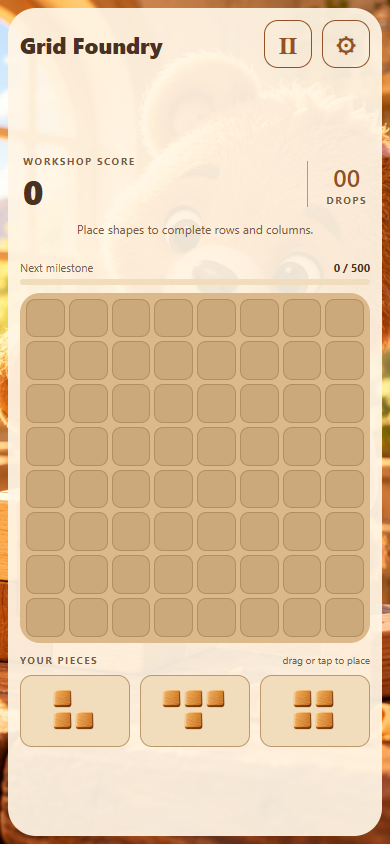
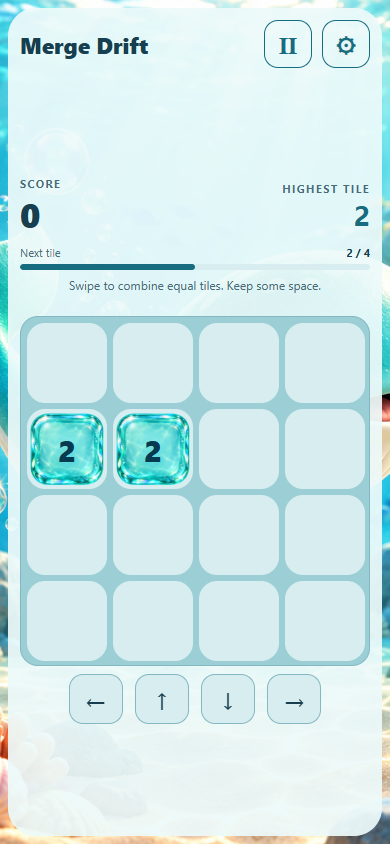
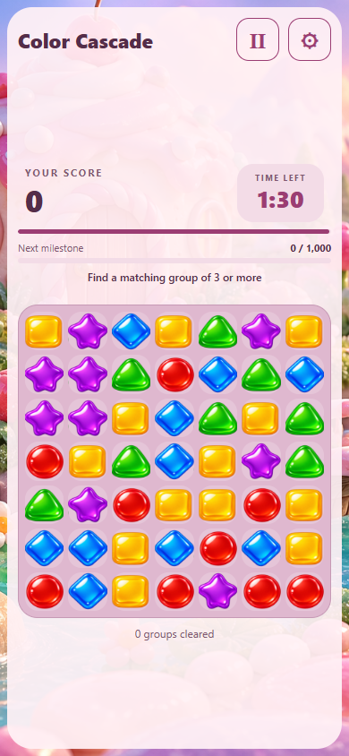

# Rice Puzzle Arcade

Three small Android puzzle games built with React Native and Expo 58. Joshua Rice is building them to explore advertising-supported income: make games people can try, learn what makes them worth playing, and work toward a store release. There is no verified revenue yet.

The core gameplay runs offline. Advertising and rewarded-video features need a network connection and a native Android build.

| App | Play | Android package (provisional until Play registration) |
| --- | --- | --- |
| Grid Foundry | Place shapes on an 8×8 grid; clear rows and columns | `com.joshuarice.gridfoundry` |
| Merge Drift | Swipe a 4×4 board; combine equal numbers | `com.joshuarice.mergedrift` |
| Color Cascade | Tap connected groups; score within 90 active seconds | `com.joshuarice.colorcascade` |

| Grid Foundry | Merge Drift | Color Cascade |
| --- | --- | --- |
|  |  |  |

Actual local browser gameplay captured in Microsoft Edge on October 18, 2026, at a 390 × 844 viewport in fresh sessions. These show the web builds, not native Android or advertising acceptance. The illustrations are in-game assets; these captures are not design mockups.

## Try it and current status

Run a browser preview below, or follow the [Android build guide](docs/BUILD.md) for a native development build. There is no verified public web demo or app-store release linked here. Gameplay and saves run locally; native advertising needs connectivity and a development/internal Android build.

The games are under active development. Normal play, daily challenges and saved journey progression are implemented. Store publication, audience/privacy review and production advertising are separate release gates. [Status](STATUS.md), [current advertising integration](docs/AD_INTEGRATION.md) and [account setup notes](docs/ACCOUNT_SETUP_STATUS.md) retain dated evidence and remaining work; no users, revenue or commercial success are claimed.

## Run

Use Node 24 and pnpm 11.25.0. From the repository root:

```sh
pnpm install --frozen-lockfile
pnpm --filter @arcade/grid-foundry web
pnpm --filter @arcade/merge-drift web
pnpm --filter @arcade/color-cascade web
```

Browser builds run the actual shared gameplay and persistence, with advertising disabled. Native AdMob needs a development or internal Android build, not Expo Go. See `docs/BUILD.md` for installable artifacts and native build commands.

Run one preview command at a time, or use separate terminals and accept Expo's available-port prompt. The terminal prints the local URL. Browser previews cannot earn native ad rewards; journey stages requiring an earned reward need an Android build.

## Engineering worth inspecting

Each game separates a pure, seeded state engine from React Native rendering. [Merge Drift](apps/merge-drift/game.ts), for example, stores its random-generator state with the board and validates restored saves. This makes the next move reproducible across saves and keeps invalid persisted state out of gameplay. [Engine tests](apps/merge-drift/game.test.ts) document replay and restore cases; this overview is not a new test run.

The [advertising adapter](packages/ads) separates SDK events from game state: an earned callback grants a reward, while dismissal or failure cannot invent one. The games and this documentation were developed with AI assistance; implementation and generated assets should be evaluated on their behavior and evidence.

## Layout

- `apps/*/game.ts`: pure, seeded, separately tested engines
- `apps/*/GameScreen.tsx`: distinct touch controls, animation and visual design
- `packages/ui`: shared launch, pause, tutorial, preferences and results flow
- `packages/game-utils`: versioned local saves and statistics
- `packages/ads`: native UMP/AdMob adapter and tested advertisement lifecycle
- `website`: publisher site source; see current account and release notes for publication status

Each app saves progress on-device. Daily challenges derive a seed from the local calendar date and app name. Randomness and game difficulty never read advertising or consent data.

## Advertising and publishing

Development/internal builds use official Google sample IDs. An optional earned reward can revive a run once; dismissal or failure cannot award it. Interstitials are limited to end-of-run transitions with session, round-count and cooldown requirements. Web never simulates a successful ad.

Production serving is separate from internal test integration. Current owner/account configuration is recorded in [account setup](docs/ACCOUNT_SETUP_STATUS.md); store linking, audience/privacy review and release gates remain documented in [blockers](docs/BLOCKERS.md). No store release, paid impressions or earnings are claimed here.

No signing credentials belong in Git. Android native directories are generated from the reviewed app configurations; package IDs and target API are verified during prebuild/CI.

## Development checks

The existing project checks are `pnpm test` and `pnpm typecheck`. See the dated verification records in `docs/` for what was actually run and its limits.
