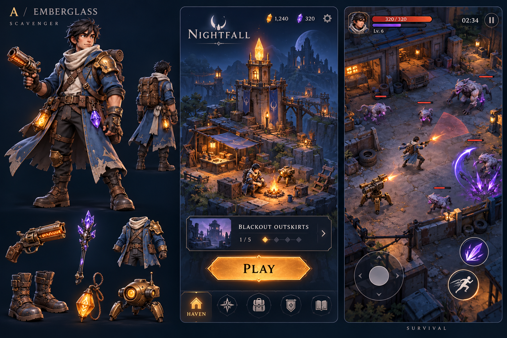
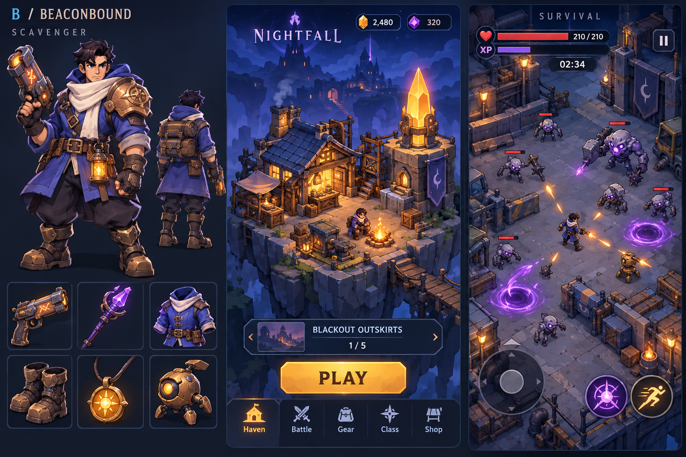
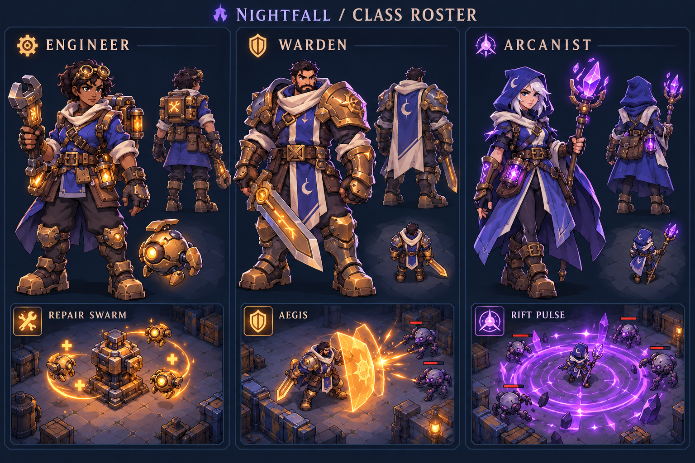
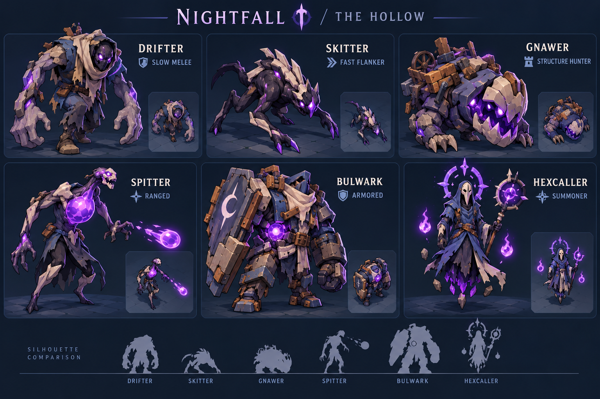
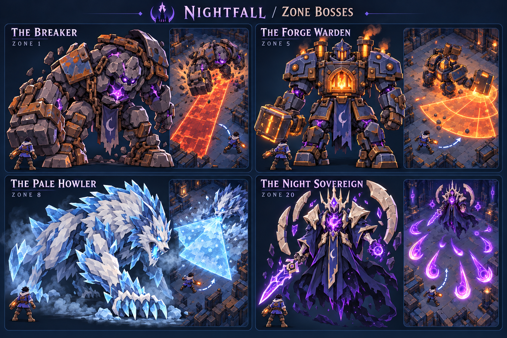
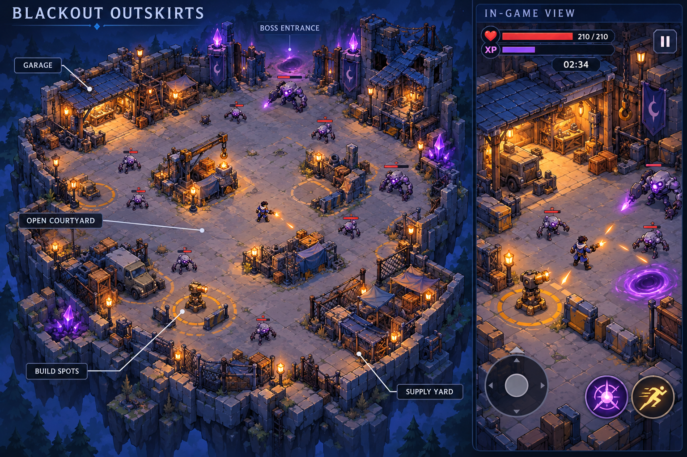
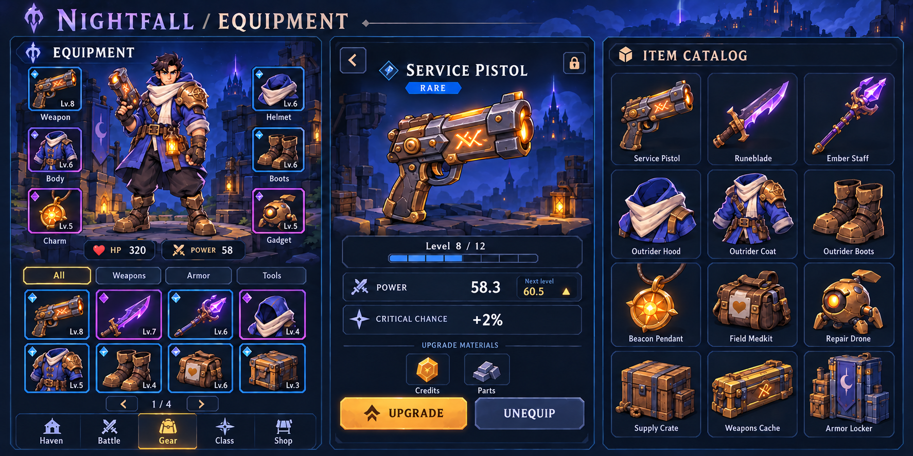

# Nightfall Art Direction Review

October 18, 2026. Joshua selected Direction B (Beaconbound): "i like B lets go with that style." Concept exploration only; no game code, assets in a runtime, or layouts have been implemented in this pass.

## Main design

The [Nightfall Main Design Plan](NIGHTFALL_MAIN_PLAN.md) is the canonical gameplay plan. Its complete latest conversation version is preserved verbatim beneath the document header. The [earlier design archive](archive/2026-10-18-earlier-objective-design.md) preserves earlier detailed proposals without making its superseded campaign rules current.

The campaign is graphical mobile survival: survive timed waves, then kill the boss without a second timer. Extra rewards depend on performance and collection. These images do not alter that rule.

## Shared visual requirements

- Portrait phone layout, with the whole combat HUD and controls on screen.
- Original stylized characters, visible equipment, magical salvage machinery, a welcoming home refuge, and readable top-down action.
- Navy, slate/cobalt blue, violet, ivory, and amber. Avoid green as the default interface or terrain palette.
- The Scavenger, rune pistol, magic staff, coat, boots, charm, and repair drone appear alongside a Haven home concept and combat layout.
- Equipment needs clear silhouettes at small inventory sizes. Combat effects must leave enemy attacks visible.
- The boards are raster concept illustrations, not final sprites, 3D models, animated assets, or functional screenshots. UI labels, sample statistics, and currency counters are illustrative. Actual navigation and rewards follow the main plan until separately revised.

## Direction A — Emberglass

Detailed sculpted fantasy treatment, weathered materials, taller hero proportions, warm beacon light, and a more cinematic environment. Strong atmosphere; fine detail would need simplification for actual mobile sprites and performance.

## Direction B — Beaconbound

Selected visual direction. Chunkier illustrated/cel-shaded treatment, broader shapes, cleaner item silhouettes, larger boots and hands, stronger contours, and a more compact home diorama. Small-screen readability and performance still require actual device testing.

## Review status

Direction B is approved as the visual style; A is retained as an unselected exploration. A and B are working style labels, not competing game titles. The expanded class, enemy, boss, map, and inventory concepts below are awaiting review of their individual designs. Character identities and cosmetic details are proposals, not new gameplay requirements. Standalone assets, animation, runtime UI, collisions, and camera behavior are not implemented.

## Classes

Engineer with repair drones, Warden with Aegis, and Arcanist with Rift Pulse. Front/rear views and ability vignettes explore consistent silhouettes beside the existing Scavenger. The Warden's shield is an ability effect, not a seventh equipment slot.

## Enemies

Drifter, Skitter, Gnawer, Spitter, Bulwark, and Hexcaller. Larger silhouettes show role differences; miniature top-down views explore readability. Fine surface details will need simplification at real gameplay scale.

## Bosses

The Breaker (Zone 1), The Forge Warden (Zone 5), The Pale Howler (Zone 8), and The Night Sovereign (Zone 20), with illustrative attack-warning vignettes. These do not establish final hitboxes or encounter balance.

## Blackout Outskirts arena

Full arena overview and a proposed portrait gameplay camera view. An open central courtyard and connecting paths provide space for movement, collection detours, and optional building. The boss entrance leads into the same arena; there is no separate boss-room objective or extraction exit. Labels and build circles are design annotations, not required final UI.

The full-map overview is for review; the phone follows the player at a closer scale. Scrolling the camera through the world is distinct from scrolling a webpage to reach controls. The HUD and controls remain within the phone viewport. Collision clearance, enemy navigation, roof occlusion, and safe dodge distances remain to be validated in a future authorized prototype.

## Equipment and inventory

Six equipped slots, a paged inventory, item details, and twelve catalog objects. The final board corrects the initial generated preview: a level upgrade increases Power but not the critical-chance affix, uses Credits and Parts rather than Gems, and uses amber instead of green for the improvement indicator. The medkit uses a heart emblem.

Sample numbers and inventory contents illustrate the layout, not a saved player state. Power 58.3 for a level-8 Rare pistol and next-level 60.5 match the proposed primary-stat formula to one decimal. The page has not been built or tested at a phone viewport. The catalog panel is an art sheet, not an extra in-game screen column.

## Provenance

Both boards were generated with the built-in image_gen tool. Exact generation prompts are preserved in [PROMPTS.md](art-concepts/PROMPTS.md). Originals remain in the Codex generated-images directory; workspace copies are versioned with this plan.

The five additional Beaconbound boards were generated with the built-in image_gen tool using the selected B board as their style reference. Their exact prompts and the inventory correction prompt are preserved in [BEACONBOUND_PROMPTS.md](art-concepts/BEACONBOUND_PROMPTS.md).
