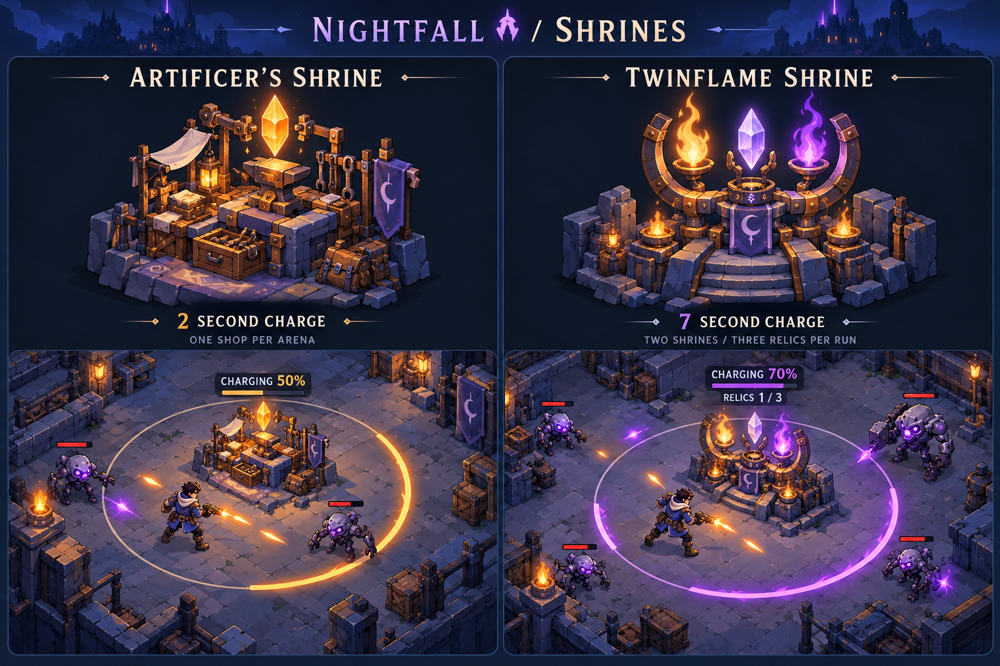
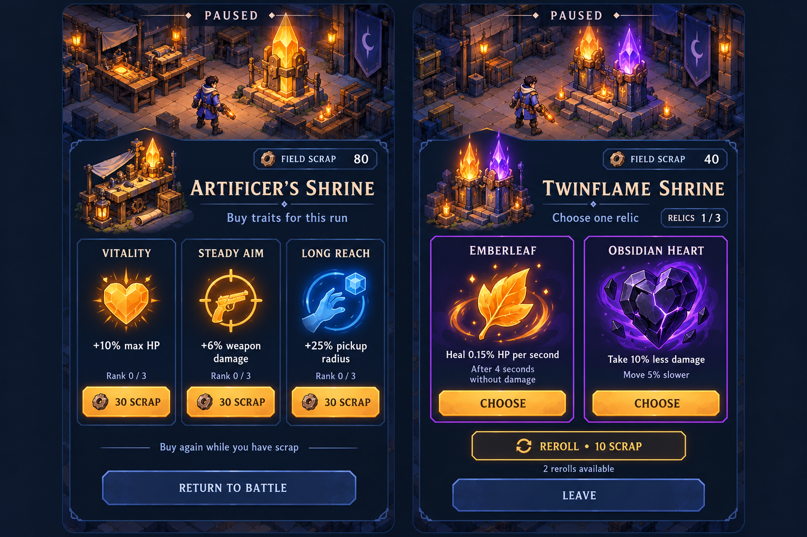
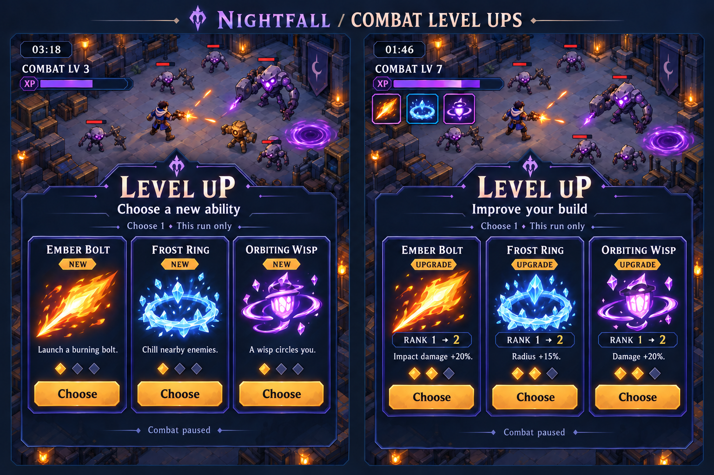
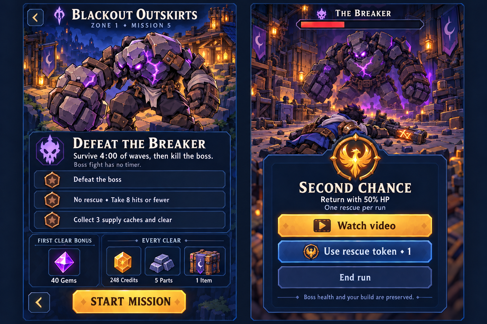

# Nightfall Shrines and Run Interface Concepts

October 18, 2026. Visual exploration and working design notes following the main plan. Style B is selected; the new screens and numerical tuning remain proposals for review. No gameplay, ads, currencies, or UI functionality was implemented. The campaign still requires surviving timed waves and then killing the boss, without a second timer.

## User direction and proposed tuning

The user requested two shrine types, activated by staying nearby while a circular progress indicator fills. The shop charges quickly, appears once per arena, and supports repeat purchases while the player has money. The buff shrine charges slowly, appears in a couple of places, offers two choices, and allows three buff selections per game. Paid rerolls were requested for the buff choices.

The concrete tuning below is the working proposal used by these images, not tested balance. It replaces the earlier one-use shop proposal in the conversation. These notes supplement the main plan; they do not authorize implementation.

| Rule | Artificer's Shrine | Twinflame Shrine |
| --- | --- | --- |
| Count | One per arena | Two per arena |
| Charge | 2 seconds | 7 seconds |
| Reward | Purchase temporary stat traits | Choose one of two temporary Relics |
| Limit | Repeat purchases within available funds, trait ranks, and stat caps | Three total accepted Relics shared across both shrines per attempt |
| Currency | Field Scrap, not permanent Credits or Gems | Initial choice free; rerolls cost Field Scrap |
| Repeat use | Recharge on a return visit; multiple purchases allowed in one visit | Used shrine rests 45 seconds; other shrine stays available |

## Proximity charging

- A clear ground circle marks the radius and a thicker arc fills clockwise.
- Movement, attacks, dodges, enemy attacks, and the wave timer continue during charging.
- Taking damage does not cancel charging.
- Leaving stops progress immediately; after a one-second grace period, progress drains over three seconds.
- Reaching full charge opens a paused selection screen. Only the selection screen pauses combat and the wave timer.
- A shared Relics counter is separate from the charging percentage. The three-choice cap is per attempt, not per shrine; each selection awards one Relic, not both displayed options.

## Shop and Relic choices

Shop examples: Vitality +10% maximum HP, Steady Aim +6% weapon damage, Long Reach +25% pickup radius. Repeatable traits have up to three ranks, with proposed costs 30, 45, and 65 Scrap. Global stat caps still apply; offers must display the actual eligible benefit, with maxed traits replaced. These traits are run-only and do not consume the three combat-passive slots. Maximum-HP increases also restore the newly added HP.

Twinflame examples: Emberleaf heals 0.15% maximum HP per second after four seconds without damage and stops healing when hit; Obsidian Heart reduces damage taken by 10% but reduces movement speed by 5%. Other discussed candidates include Storm Feather (15% faster dodge recharge, 5% lower basic weapon damage) and Wisp Lantern (an additional wisp within existing damage/hit-rate limits). Numeric effects require balance review.

Choose one of two offers for free. Proposed reroll costs are 10 then 20 Scrap, at most twice per selection. Only accepting a Relic consumes one of the three selections. Leaving is free. Reopening should preserve the pending offers and reroll state so leaving cannot provide free rerolls. This offer-persistence detail is a proposed edge-case rule. Benefits are distinct and obey existing caps; they expire after the attempt.

## Combat level-up choices

The two screens distinguish learning a new ability from improving an existing one. New ability cards explain the behavior and show the first rank; upgrade cards show the rank transition and the specific improvement. Earned level-up choices have no purchase price in this concept. Three options are shown, and only one is chosen. Combat pauses for the choice.

Illustrative upgrades are Ember Bolt impact damage +20%, Frost Ring radius +15%, and Orbiting Wisp damage +20%. These are visual examples for later tuning, not a replacement ability catalog. The final board corrects the initial generated right-hand NEW labels to UPGRADE. Skill rank diamonds are distinct from equipment rarity.

## Mission preview and rescue

The mission preview shows Zone 1 Mission 5, four minutes of normal waves, then a required Breaker kill with no boss timer. It separates the three mastery conditions and first-clear rewards from repeatable clear rewards. Existing mastery targets remain: defeat the boss; clear without rescue within the damaging-hit allowance; collect the supply-cache target and clear. The proposed shrine system does not silently change those targets.

Sample rewards use the current economy: 40 first-clear Gems (10 mission plus 30 finale), 248 Credits and 5 Parts (rounded from the proposed Zone 1 finale multipliers), and one boss equipment item. This simplified concept omits XP and the zone-specific crafting material; it is not the exhaustive production reward list. Costs and balances remain proposals.

The rescue screen offers Watch video, Use rescue token, and End run. No countdown or Gem price is shown. At most one rescue is allowed per attempt across methods, restoring 50% HP and preserving the boss's remaining HP and the player's build. Once-per-attempt effects and cooldowns do not reset. An ad reward would require a successful earned-reward callback; the illustration does not demonstrate working ads. A rescued clear unlocks the next mission but does not earn the no-rescue combat medal.

## Visual and verification status

All four boards are original AI-generated raster concepts in the selected navy, cobalt, amber, ivory, and violet style. The round arena props and selection menus will need a single shared asset design if implemented; generated scenes are not exact reusable geometry. Phone fit, text size, touch targets, animation, safe areas, and gameplay performance have not been device-tested. The images do not change the game's source or existing prototype.

Exact prompts, references, and the targeted correction are saved in [SHRINE_UI_PROMPTS.md](art-concepts/SHRINE_UI_PROMPTS.md). The [main design plan](NIGHTFALL_MAIN_PLAN.md) and [art review](ART_DIRECTION.md) remain the entry points.
