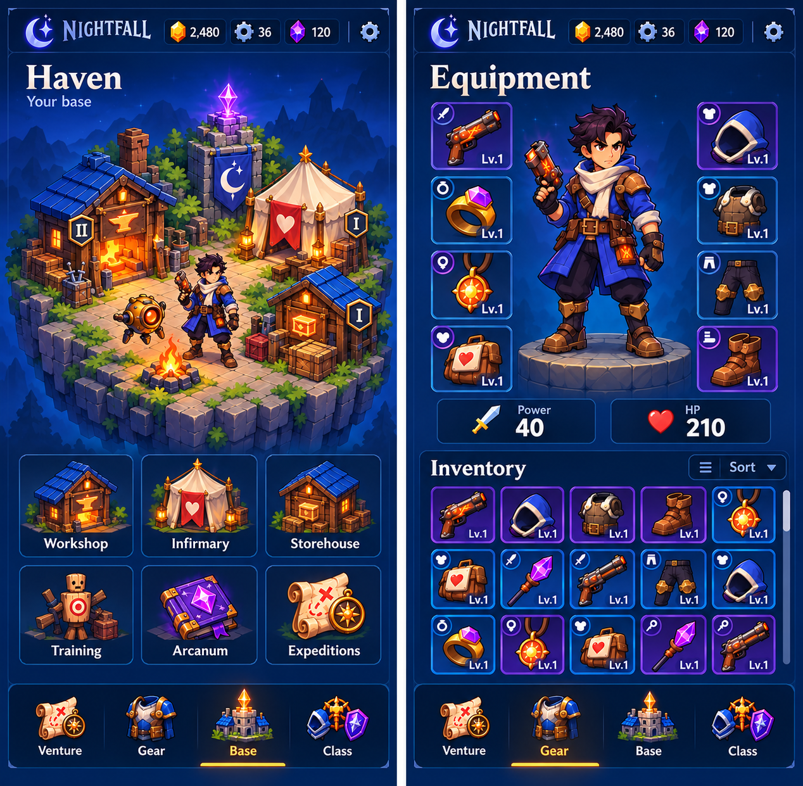

# Nightfall Visual Quality Plan

October 18, 2026. Owner: Joshua Rice. Design and engineering lead: Codex.

**Status: Gear V0–V2 implementation authorized and in review; visual acceptance remains open.** On October 18 Joshua explicitly authorized an art agent to start this plan in parallel with feature development, then requested the reference item-detail composition as a popup over dimmed Gear. The earlier deferred status is superseded for this bounded Gear slice. The original rejected visual baseline remains `d6e3626`; this iteration is built on `4e30cb8` plus the coordinated feature work. Passing tests or exporting an APK does not establish visual acceptance.

**Latest scheduling decision:** Gear art, materials, layout and item popup may proceed alongside features. Review the [Gear iteration report](visual-iterations/gear-v1/REPORT.md) and its actual Godot captures before carrying this treatment across the remaining menus. Shared rollout, installed-build review and final visual acceptance remain open.

The objective is a welcoming, polished, illustrated mobile action RPG: recognizable Nightfall identity, appealing characters, rich but restrained materials, clear equipment progression, concise interface copy, and consistent phone-scale composition. Keep Godot and the existing game systems. First bring **Gear** to the target standard, then use its accepted components and art treatment across Shop, Expedition, Base and Class. Combat presentation follows as a separate stage.

## 1. References and decision order

| Priority | Reference | Governs |
|---|---|---|
| 1 | Joshua's latest instructions in this plan | Five tabs, centered Expedition, sharper and less bulky presentation, icon-plus-number resources, original Nightfall identity |
| 2 | [Sharper Base and Gear concept](art-concepts/nightfall-b-sharper-base-gear.png) | Main Nightfall mood, hero proportions, equipment framing, illustrated materials, compact visual hierarchy |
| 3 | [Simpler eight-slot concept](art-concepts/nightfall-b-haven-eight-slot-gear.png) and [Gear concept](art-concepts/nightfall-b-gear-screen.png) | Eight equipment positions, five-column inventory, strong character focus |
| 4 | Supplied Undead Slayer screenshots in the design conversation | Perceived finish: readable silhouettes, cohesive icon scale, satisfying cards, strong primary action, visual reward feedback |
| 5 | [Base](art-concepts/nightfall-b-base-screen.png), [Expedition](art-concepts/nightfall-b-venture-screen.png), [Class](art-concepts/nightfall-b-class-screen.png) concepts | Content and composition adapted to the current five-tab navigation |
| Baseline | [Current Gear](visual-baseline/gear-d6e3626.png), [current Base](visual-baseline/base-d6e3626.png), [implementation QA](HOME_PRODUCT_QA.md) | Before images and existing behavior to preserve; these are not accepted visual targets |

The approved concepts contain historical four-tab layouts and illustrative currencies/items. Follow the latest five-tab requirements and real profile data. Do not reproduce invented balances, obsolete labels, nonexistent offers, or extra inventory merely because a concept contains them. Use Undead Slayer as a quality and interaction reference; produce original Nightfall art, names, characters and UI assets. These screenshots do not establish that game's engine or production workflow.

## 2. What must change

| Current weakness | Required correction | Evidence of improvement |
|---|---|---|
| Better illustrations sitting inside generic rectangles | Purpose-designed game UI materials, integrated edges, hierarchy and feedback | Gear reads as one designed screen, not an illustration embedded in a settings panel |
| Flat polygon pedestal and floating cutout appearance | Illustrated stone plinth, aligned feet, contact shadow, consistent scene lighting | Character appears grounded in both still capture and idle animation |
| Busy full-screen landscape competing with controls | Quiet character stage, darker inventory surface, selective scenery | Hero and items remain the focal points at actual phone size |
| A visible rectangular seam around Base scenery | Isolated layers or edge-compatible composition, atmosphere behind the island | No obvious pasted square against a different background |
| Large headings and long, equally weighted buttons | Compact titles, short action labels, art-led cards, details on inspection | More usable inventory/art space without reducing touch targets |
| Icons vary in padding, apparent size and finish | Shared icon view angle, light source, outline weight and optical sizing | Different objects feel equally important in equal-size slots |
| Rarity mostly communicated by a border recolor | Six deliberate frame treatments, named tiers in details, restrained tier accents | Progression feels valuable without hiding item silhouettes |
| Generic motion or static menu figures | Small intentional idle cycles, grounded movement and responsive UI | A short recording feels like a game rather than a static mockup |
| Functional tests treated as visual acceptance | Same-size reference comparisons plus human review | Completion includes screenshots, interaction recording and explicit remaining differences |

Do not respond to this gap by adding more glow everywhere, increasing saturation indiscriminately, generating another whole-screen mockup and calling it implemented, or switching engines. The main work is faithful composition and consistent asset production.

## 3. Locked visual direction

### Palette and materials

Use midnight blue as the resting surface, cobalt as the world and magic atmosphere, ivory for important text, amber/gold for primary actions, and violet for rare magic. Starting color tokens below are implementation targets to tune against the actual reference, not a claim that its pixels have been sampled.

| Token | Starting value | Use |
|---|---|---|
| Deep surface | `#071C42` | Inventory well, nav and header backing |
| Raised surface | `#12376E` | Secondary controls and inspected-item surfaces |
| Cobalt | `#245FC8` | Scene lighting and active blue accents |
| Edge highlight | `#6CA9EB` | Thin lit edges, never thick outlines on every panel |
| Ivory | `#F2F2FF` | Main text and symbols |
| Muted text | `#B7C9E7` | Secondary information |
| Amber | `#FFC64D` | Primary actions and selected-navigation indicator |
| Violet | `#A56AF1` | Magic and Epic framing |

No green default UI. Preserve conventional semantic indicators only where useful; success can also use an ivory checkmark and amber flash. Materials should suggest enamel, cut crystal, warm metal and carved stone. Each component gets a subtle lit upper edge and grounded lower edge. Avoid heavy bevels, oversized gold borders and noisy stone texture behind text.

### Shape, lighting and typography

- Keep the Beaconbound character silhouette: readable head/hands, recognizable costume, clean angular details, warm face and equipment highlights. Sharper means crisper proportions and edges, not a cold enterprise dashboard.
- Use one consistent upper-left warm key light, cool blue ambient fill, and restrained violet magic accents across heroes, gear and buildings.
- Use the Nightfall crescent and custom-arranged wordmark once in the header. Do not repeat branding in content panels.
- Keep Cinzel as a candidate for the logo and short display headings; compare its small-size legibility against the reference before locking it. Barlow Semi Condensed remains a candidate for labels and numbers. Avoid using large all-capital fantasy type for every line.
- Starting type scale at the design size: screen title 23–27, section title 18–21, primary numeric values 22–28, control labels 15–17, secondary labels 13–14. Inspect at small phone size; do not solve overflow by shrinking essential text below readability.
- Headers and navigation use a shared spacing system: 4, 8, 12, 16 and 24 design units. Optical adjustment is allowed where an icon shape requires it.

## 4. Build the Gear reference screen first

### Composition

Design at 430×760, then solve safe areas and smaller phones with real layout constraints. These proportions are an initial composition guide, not fixed pixel constraints that override text or touch accessibility:

| Region | Approximate share of usable height | Requirement |
|---|---|---|
| Shared header | 8% | Moon/wordmark, three resource icons with numbers, Settings |
| Equipment title | 4% | Compact and aligned; no large empty gap above hero |
| Character and eight slots | 31% | Character is the clear focal point; four slots per side |
| Key stats | 6% | Power and HP visually strongest; Armor compact but accessible |
| Inventory toolbar | 5% | Inventory count, short Sort control |
| Inventory well | 36% | Five columns; aim for at least three complete rows at design size when enough items exist |
| Bottom navigation | 10% | Five fixed tabs, Expedition centered |

Only the inventory scrolls. At short viewports, reduce decorative title space and pedestal/hero area before sacrificing touch targets or hiding controls. Fewer visible inventory rows are acceptable on smaller phones. Do not force the entire screen to scroll or stretch character artwork to fill available space.

### Character stage

1. Produce a stone pedestal with an illustrated top surface and visible front thickness. Replace the plain polygon as final artwork.
2. Align both feet to its contact plane. Use a separate soft contact shadow that follows the pose; avoid a large generic dark circle floating beneath the character.
3. Establish a calm blue/violet halo behind the upper body. Keep its brightest area below the face and behind the silhouette, not behind text.
4. Separate the character into useful animation layers or produce a short consistent idle loop. The first pass needs breathing, a small cloth movement and a restrained weapon glow; no whole-character bobbing that slides the feet.
5. The currently equipped class determines the portrait. Do not imply that every armor change modifies the full character model until that visual system exists.

### Equipment slots and inventory

- Left: Weapon, Ring, Pendant, Gadget. Right: Head, Chest, Pants, Boots.
- Use the same item art in its equipped slot, inventory card, inspection and reward reveal.
- Frames have a quiet internal gradient, thin material border, a small slot badge and legible level label. Equipped state uses a small consistent marker with an accessible explanation.
- Let item art fill roughly 72–82% of its available icon area after optical adjustment. Do not crop off pistol barrels, pendant cords or boots to reach a numerical fill target.
- Keep cards square or nearly square. A five-column grid must not become four columns, horizontal pages, or a horizontally scrolling strip.
- Empty inventory space remains honest; never add dummy items to make the screen look rich. Use a calm inventory surface and deliberate empty state.
- Sort has a short label and menu containing the actual supported choices. No decorative filter tabs with no behavior.
- Tapping a card opens a consistent inspection panel with item image, name, rarity, level, exact stats, comparison, cost and action. Move long set-bonus and special-effect explanations here.

### Rarity treatment

| Tier | Frame treatment | Restraint |
|---|---|---|
| Common | Silver/slate with a cool edge | Still finished and attractive; no glow |
| Uncommon | Cyan-blue enamel | One stronger edge accent |
| Rare | Sapphire | Small inset corner detail |
| Epic | Violet | Restrained inner light and a distinctive corner motif |
| Legendary | Amber/gold | Metallic highlight, richer corner detail |
| Mythic | Rose/crimson with violet energy | Distinct emblem; brief reveal effect rather than constant flashing |

Name the rarity in details and provide a non-color marker where appropriate. Never change an item's real rarity to make a demonstration prettier. Review both the real eight-item starter inventory and a separate clearly labeled mixed-rarity test profile.

## 5. Shared interface components

Implement these only after the Gear composition is convincing. Reuse them rather than reskinning each screen independently.

| Component | Planned states and behavior |
|---|---|
| Header wallet | Icon and amount; zero, large values, compact formatting, tap/accessible name revealing currency and exact amount |
| Bottom tab | Original illustrated icon, short label, consistent optical size, selected amber underline/edge, pressed state, safe-area clearance |
| Primary action | Amber material, strong label, thin highlight, pressed depth, disabled and busy states |
| Secondary action | Blue material, quieter hierarchy, same corner language |
| Item tile | Six rarities, equipped marker, level, selected/focused/pressed states; clipped to the scroll viewport |
| Stat badge | Icon, numeric value and optional compact label; no unclear unlabeled secondary stat |
| Cost row | Currency icon and number adjacent to the action; insufficient-resource state remains readable |
| Modal/panel | Consistent title, art area, concise details, clear close/back action and safe touch space |
| Reward reveal | Item art, true rarity, quantities, concise result, animation skippable without losing rewards |
| Notice | Small contextual status for locks, errors and saves; avoid a permanent large paragraph under every page |

Visual state must follow real state. A completed callback, successful save, insufficient balance, unavailable ad and cancelled ad need different presentations. Do not use celebratory animation before a reward is earned and saved.

## 6. Remaining screens

### Base and Haven

Haven is the settlement; Base is the navigation label. Keep one central illustrated island containing Workshop, Infirmary, Storehouse, beacon, fire and selected character. The character must stand inside the courtyard at its scale and perspective, rather than on the island's front edge as a separate sticker.

Replace the opaque square scene with separable foreground, building, character, light and atmosphere layers or an equivalent clean composition. Preserve a clear ground plane. Buildings must be recognizable without floating sentences. Small rank badges and six clear shortcuts provide discovery: Workshop, Infirmary, Storehouse, Training, Arcanum, Expedition.

Building inspection should retain context, display current rank, the exact upgrade benefit, icon costs, and one upgrade action. Rank II should change the relevant building's appearance. Add candle/fire flicker, a gentle beacon cycle and restrained smoke. Reduced-effects mode removes decorative particles and parallax. No new timers, construction mechanics or facility costs are introduced by this visual work.

### Expedition

Use one zone diorama, compact zone title, five mission nodes, mastery progress, reward preview and one strong Start/Resume action. Locked nodes should visibly differ from available/completed/selected nodes using a lock or completion symbol as well as color. Keep secondary game modes quieter than the main campaign action.

Mission inspection contains the boss portrait, completion rule and bonus objectives. Preserve timed survival followed by mandatory boss defeat, with no second timer. Remove repeated explanations from the selection page. Use actual unlocks and mastery data; later-zone artwork does not make those zones playable.

### Class

Present a large consistent hero preview, class crest, short identity line and mastery track. Use four purpose-made class badges or portrait crops; tiny full-body figures are poor selectors. Show the selected class clearly, future classes as previews, and exact unlock requirements on inspection. Put full stat effects and mastery details behind an obvious details action. All four heroes must share body scale, lighting, pose framing and ground plane.

### Shop

Use illustrated offer cards grouped by purpose: chests, optional ad reward, earned-currency supplies. Put the reward first, the cost or video symbol second, and a short action last. Show a key icon with its count instead of paragraphs. Avoid a stack of equally wide text buttons with no visual distinction.

Keep the rewarded offer visibly optional and describe the actual reward. Show loading, unavailable, completed and daily-limit states in the same card. Preserve token-bound reward/save behavior. Do not display fake working real-money products or invent prices. Paid-product design can be added when products and billing actually exist.

### Secondary screens

Apply the same inspection, cost and action components to Infirmary, Workshop, Storehouse, Mastery, chest results, salvage confirmation, contracts and settings. Essential descriptions stay available; reducing words must not hide costs, effects or destructive actions. Avoid a polished main menu that leads into an unrelated-looking utility screen.

## 7. Asset production list and quality checks

| Asset group | Initial deliverables | Priority |
|---|---|---|
| Brand and backdrop | Crescent/wordmark treatment, quiet blue backdrop layers, header/nav surfaces | Gear stage |
| Hero stage | Scavenger portrait/idle layers, stone pedestal, contact shadow, restrained light overlays | Gear stage |
| Equipment | Eight coherent starter icons; improved crops and consistent silhouettes | Gear stage |
| Frames | Six rarity families plus state overlays; shared level/slot/equipped badges | Gear stage |
| Resources/stats | Credits, Parts, Gems, key, Power, HP, Armor; consistent style and optical weight | Gear stage |
| Controls | Primary/secondary buttons, focus/pressed/disabled states, panel and inventory materials | Gear stage |
| Navigation | Shop, Gear, Expedition, Base, Class icons at their real phone display sizes | Gear stage |
| Base | Island/ground layers; Workshop, Infirmary, Storehouse I/II; beacon/fire; six shortcut icons | After Gear review |
| Classes | Engineer, Warden and Arcanist portraits/idle layers plus four selector crests | Shared rollout |
| Expedition/rewards | Outskirts diorama refinement, node states, reward chest closed/open and reveal effects | Shared rollout |

For every asset: record purpose, reference, dimensions, transparent bounds, pivot/ground contact where applicable, intended display size, output filename, source/prompt and approval status. Preserve source artwork separately from optimized runtime output.

Generate a small coherent set against the same reference before expanding. Inspect transparency over both light and dark backgrounds, silhouettes at 48/64/96-pixel previews, unwanted halos, baked-in text, stray fragments and atlas bleed. Do not bake text, balances or interactive controls into a scene illustration. Tight cropping must preserve enough atlas padding for filtered scaling. Use vector artwork for simple symbols and raster artwork where illustrated material and character detail matter.

## 8. Godot implementation approach

Continue in the existing Godot project. Use its UI controls, reusable scenes, themes, texture-backed panels, layered sprites and animation tools. No engine migration, Docker requirement, subscription purchase or full 3D conversion is planned for this visual pass. The existing image-generation tool supplies illustrations; it does not replace layout engineering or visual review.

Known integration points are `haven_ui.gd` for screen composition, `haven_art.gd` for artwork selection, `preparation_ui.gd` and `loot_ui.gd` for secondary flows, and `arena.gd` for home/ads integration. Keep `profile.gd`, loot rules and saved state as the existing source of truth. Inspect actual callers before refactoring during implementation.

Extract repeated visual components only where the new design needs them. Prefer Godot containers and safe-area-aware anchors over adding more fixed-coordinate patches. Keep the eight-slot mapping and five-column scroll behavior. Animation should not rebuild the whole menu, reallocate textures every frame, or modify profile state. Disable hidden-screen animation and preserve the existing distinction between home input and combat input.

Use layered 2D character animation for the first quality pass. If that cannot reach the desired presentation after a bounded prototype review, evaluate a pre-rendered animated portrait or a Godot 3D menu character separately. That decision depends on visible benefit and asset-production cost; it is not a reason to restart the game.

## 9. Motion and interaction targets

Starting timings to verify by touch, not rigid promises:

- Button press: immediate response; 80–120 ms depth/scale settle, about 2–3% compression rather than a large bounce.
- Panel/tab transition: 150–220 ms, short travel or fade; avoid moving the whole screen dramatically.
- Item selection: brief edge emphasis; selection must remain visible without animation.
- Hero idle: 3–5 second breathing cycle with grounded feet; optional slow cloth motion.
- Beacon/fire: asynchronous 2–4 second cycles so the scene does not pulse in unison.
- Reward reveal: 500–900 ms, skippable; reward state must remain correct if interrupted or the app backgrounds.

Decorative motion stops in reduced-effects mode. Focus, selection and success still have static equivalents. No constant pulsing of every Shop button, no repeated automatic reward popups, and no screen-wide glow that obscures items.

## 10. Delivery sequence and review gates

| Stage | Work and deliverable | Exit condition |
|---|---|---|
| V0 Reference lock | Preserve baseline images; annotate desired proportions, materials and hierarchy; inventory usable assets | Clear screen specification and asset checklist; no conflicting historical labels |
| V1 Gear still | Build actual Gear with starter data, improved stage, frames, typography, wallet and navigation | Real in-engine capture resembles the approved composition at phone size; no placeholder geometry presented as final |
| V2 Gear interaction | Item details, scrolling, sort, costs, disabled states and restrained animation | Starter and mixed-rarity inventories work; no overlaps; short recording shows responsive and coherent presentation |
| V3 Gear visual review | Compare reference, baseline and candidate at equal size; record specific remaining differences | Joshua's feedback is addressed before reproducing the treatment across all menus |
| V4 Shared rollout | Carry accepted components through Base, Expedition, Class, Shop and secondary screens | Screens feel like one game; facilities and current reward/save behavior still work |
| V5 Native review | Android export/install, actual touch navigation, save/restart, reward UI return, responsive and reduced-effects checks | Evidence from installed build; no critical clipping, input or presentation defects |
| V6 Combat presentation | Separately align characters, terrain, enemies, abilities, HUD and choice cards | Same art language while attack warnings, pickups and player silhouette remain readable |

The first implementation work order is V0–V2: one complete Gear slice. Do not generate final art for every zone, class skin and possible equipment variant before that slice establishes a repeatable standard. Estimates should follow V1 asset and performance results; no fixed completion date is implied by this plan.

## 11. Phone validation and performance

Test 320×568, 360×800, 390×844 and 430×760 layout cases, plus the actual Android emulator dimensions/insets. Validate usable touch size with Android density and safe areas, not only Godot coordinate values. Aim for 44–48 logical points of hit area for primary actions and independent selection targets; art can be smaller than its invisible hit area. Ensure adjacent hit areas do not overlap.

Required profiles/states: eight starter items; at least fifty mixed-rarity items; zero and large resource values; long item names; locked classes and missions; active saved expedition; insufficient resources; maxed upgrade; ad loading/unavailable/success/cancellation; failed-save recovery; reduced effects. Keep full-screen page scrolling out of the five main screens; contained inventory and collection lists may scroll.

Initial performance goals: 60 FPS menus on the eventual chosen reference phone, with a deliberate 30 FPS reduced-effects fallback if necessary. Measure frame-time spikes during tab changes and inventory scroll, not just an average counter. An emulator pass is useful for layout and interaction but does not establish physical-device performance.

Use 1× and 2× UI exports based on measured display size; use 3× only when an actual capture shows a benefit. Start with a 64 MiB resident menu-texture budget and adjust from measured quality/device results. Include mipmap costs; avoid loading every full-resolution class and zone asset at launch. Investigate texture memory before downscaling the entire interface or blurring all icons. Confirm no persistent resource growth after repeated tab navigation and background/resume cycles.

## 12. Visual acceptance rubric

Score each category from 0–4: 0 absent/broken, 1 prototype, 2 improved but inconsistent, 3 convincingly matches the target direction, 4 polished and consistent in stills and motion. This is a review aid, not an automated claim of taste.

| Category | What the reviewer checks |
|---|---|
| Composition | Character/item hierarchy, useful space, reference proportions |
| Art consistency | Same light, outline language, perspective and optical icon scale |
| Materials and depth | Grounded character, convincing pedestal, polished frames and controls |
| Typography and copy | Readable small labels, concise wording, clear numeric hierarchy |
| Phone fit | No unintended page scroll, clipped labels, unsafe edges or undersized targets |
| Interaction and motion | Responsive states, controlled idle animation, reduced-effects support |
| Cross-screen cohesion | Main and secondary screens share the same visual language |

Proposed acceptance threshold: at least 3 in every applicable category, with no critical visual/input defects and Joshua satisfied with the direction. A high total score cannot compensate for a weak character stage or unreadable inventory. Explicitly record anything still below target. Existing tests remain regression evidence; they do not score artwork.

## 13. Evidence and handoff for each stage

Save a reference/candidate comparison at the same aspect ratio, an unaltered installed-game capture, a short interaction recording, exact build/commit identification, test results and an outstanding-differences list. Clearly label synthetic inventory fixtures. Screenshots must come from the implemented game; do not use a generated mockup as completion evidence.

Verify the actual installed package before saying the user can see a change. Preserve save compatibility and unrelated workspace work. Follow the repository Git workflow: inspect status, synchronize from the actual upstream (`master` currently; `main` is absent), implement the authorized stage, verify, synchronize again, commit and push. Do not reset user saves to make a screenshot cleaner.

## 14. Scope boundaries and definition of done

This plan changes presentation, not campaign difficulty, enemy health, forced loss rules, item power, ad frequency, reward quantities, facility costs, progression unlocks or paid products. The broader twenty-zone plan remains separate from visual production. Combat attacks remain automatic; movement and Dodge remain the direct combat controls.

The home visual overhaul is done when the accepted Gear quality has been carried through all five tabs and their secondary screens; the actual phone layout and interactions have been verified; the interface looks cohesive in motion; no temporary cutouts, flat placeholder materials or accidental image seams remain; and Joshua's visual feedback has been addressed. Until then, describe it as an iteration, not a finished polished game.
